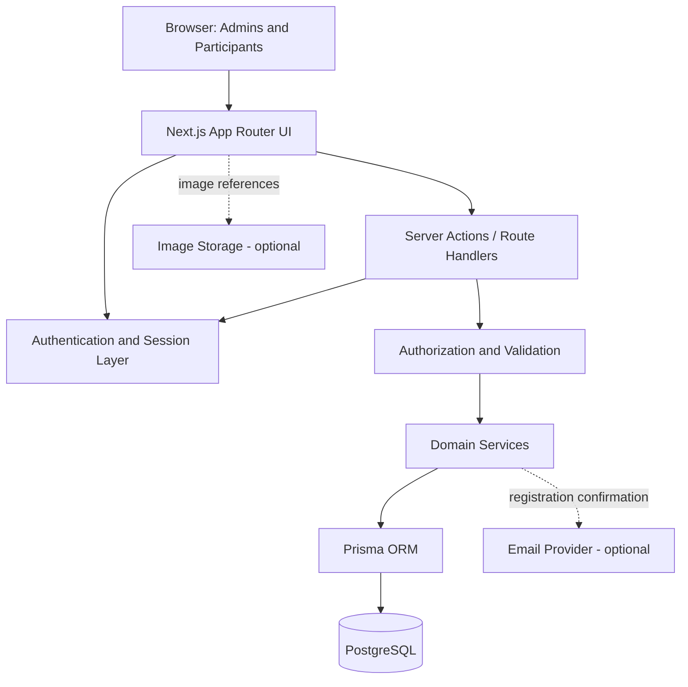
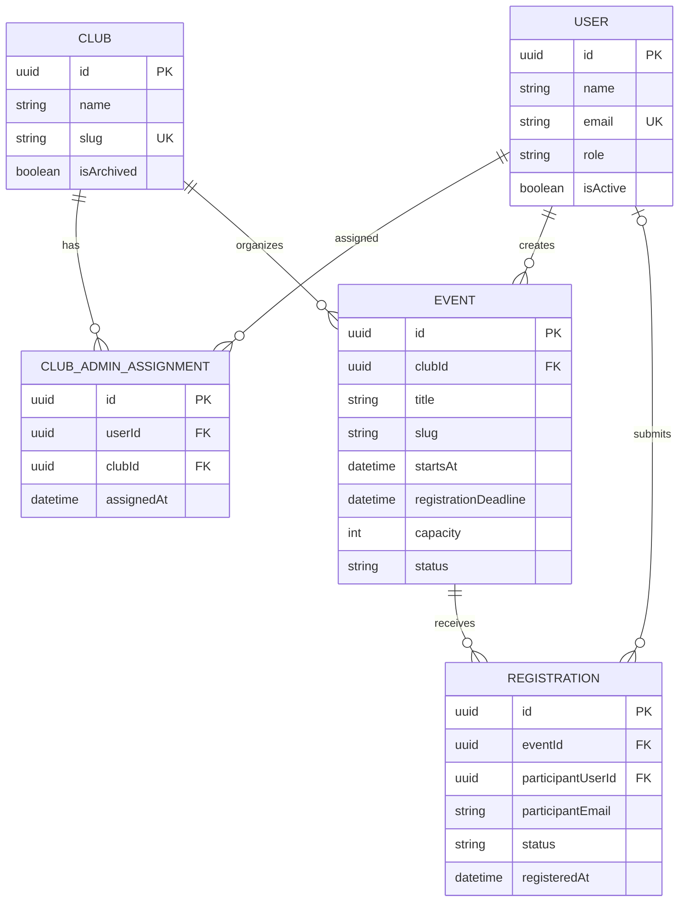
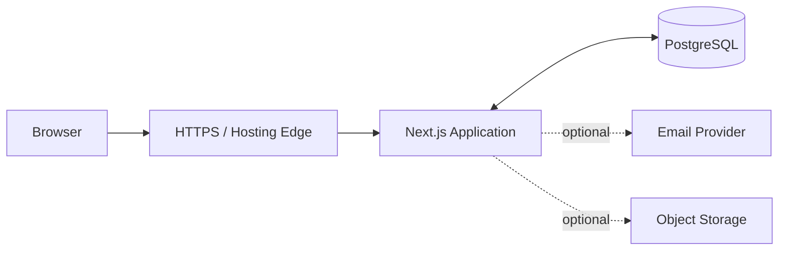

# Architecture — College Club & Event Management System

**Document type:** Software Architecture Specification  
**Version:** 1.0  
**Status:** MVP  
**Companion document:** `context.md`

---

## 1. Purpose

This document defines the technical architecture for the College Club & Event Management System MVP. It translates the product requirements in `context.md` into application boundaries, modules, data relationships, request flows, security controls, and deployment guidance.

The architecture must support three roles:

- **Super Admin:** platform-wide administration.
- **Club Admin:** management of assigned clubs, their events, and their registrations.
- **Student / Participant:** public event discovery and registration.

The MVP includes club management, event management, registration management, authentication, and role-based access control. It does not include coordinator or volunteer roles, sponsorships, payments, food or accommodation workflows, QR attendance, certificates, judging, or team registration.

---

## 2. Architecture Goals

### 2.1 Functional Goals

- Maintain a single source of truth for clubs, events, users, and registrations.
- Let Super Admins manage the entire platform.
- Restrict Club Admins to their assigned clubs.
- Let participants discover published events and register.
- Enforce registration deadlines, capacity, and duplicate-registration rules.
- Provide authorized registration search and CSV export.

### 2.2 Quality Goals

- **Security:** enforce authorization on every protected server operation.
- **Integrity:** preserve relational consistency and prevent overbooking.
- **Maintainability:** separate UI, domain logic, authorization, and data access.
- **Reliability:** handle failures without corrupting registrations.
- **Performance:** paginate lists and index common queries.
- **Simplicity:** use a modular monolith rather than separate microservices.
- **Extensibility:** allow future features without overengineering the MVP.

---

## 3. High-Level System Architecture

Use a **modular monolith**: one Next.js application with clear internal modules and one PostgreSQL database.



### 3.1 Components

1. **Browser/UI:** renders public pages and role-specific dashboards.
2. **Next.js App Router:** handles routing, server rendering, layouts, and server-side application entry points.
3. **Authentication layer:** establishes identity and validates sessions.
4. **Authorization layer:** verifies role and resource ownership.
5. **Validation layer:** validates and normalizes request input.
6. **Domain services:** implement club, event, and registration business rules.
7. **Prisma data layer:** performs typed database operations.
8. **PostgreSQL:** stores authoritative application data.
9. **Optional email provider:** sends invitations and registration confirmations.
10. **Optional object storage:** stores uploaded logos and event banners.

External email and object storage are supporting services, not sources of truth for registration or event records.

---

## 4. Architectural Style and Boundaries

### 4.1 Why a Modular Monolith

A modular monolith is suitable because the MVP has a small number of related domains and does not require independent service scaling.

Benefits:

- One deployment.
- One authentication boundary.
- Straightforward transactions.
- Easier local development.
- Lower operational cost.
- Clear module boundaries without distributed-system complexity.

Do not split clubs, events, and registrations into microservices for the MVP.

### 4.2 Domain Modules

Organize code around these domains:

- `auth`: login, session, invitation/account setup, and account status.
- `users`: administrator accounts and roles.
- `clubs`: club records and Club Admin assignments.
- `events`: event lifecycle and public discovery.
- `registrations`: registration rules, status, capacity, and exports.
- `dashboard`: authorized summary statistics.
- `shared`: database client, common validation, logging, and errors.

Each domain owns its business rules. UI components should not contain the authoritative implementation of permissions or registration logic.

### 4.3 Dependency Direction

Preferred dependency direction:

1. UI calls a server action or Route Handler.
2. Entry point authenticates the request.
3. Input is validated.
4. Authorization is checked.
5. Domain service executes business rules.
6. Data-access code uses Prisma.
7. PostgreSQL persists the result.
8. A structured result is returned to the UI.

Domain services must not trust role, user ID, or ownership data supplied by the browser. Identity comes from the validated server session.

---

## 5. Recommended Technology Stack

### Application

- Next.js App Router.
- React.
- TypeScript.
- Tailwind CSS.
- A consistent accessible UI component library, if desired.

### Backend

- Next.js Server Actions for form-oriented mutations where appropriate.
- Next.js Route Handlers for APIs, CSV downloads, or endpoints needing a clear HTTP interface.
- Shared server-side domain services for business logic.

### Data

- PostgreSQL.
- Prisma ORM.
- Version-controlled Prisma migrations.

### Validation and Forms

- Zod for server-side schemas.
- React Hook Form where complex client-side form behavior is useful.

### Authentication

Choose and configure one authentication solution compatible with the selected Next.js version. Prefer a maintained solution with secure session handling rather than building a custom password/session protocol from scratch.

### Optional Supporting Services

- SMTP or email API for invitations and registration confirmations.
- Object storage for club logos and event banners.
- Error monitoring and structured application logs.

Pin compatible package versions and test the selected versions together. Do not mix incompatible Prisma major versions or rely on undocumented configuration.

---

## 6. Suggested Project Structure

The following is a recommended structure; exact filenames can be adjusted to the chosen authentication library and Next.js version.

```text
college-event-platform/
├── prisma/
│   ├── schema.prisma
│   ├── migrations/
│   └── seed.ts
├── public/
│   └── images/
├── src/
│   ├── app/
│   │   ├── (public)/
│   │   │   ├── page.tsx
│   │   │   ├── clubs/
│   │   │   │   ├── page.tsx
│   │   │   │   └── [slug]/page.tsx
│   │   │   └── events/
│   │   │       ├── page.tsx
│   │   │       └── [slug]/
│   │   │           ├── page.tsx
│   │   │           └── register/page.tsx
│   │   ├── (auth)/
│   │   │   ├── login/page.tsx
│   │   │   └── account-setup/page.tsx
│   │   ├── admin/
│   │   │   ├── layout.tsx
│   │   │   ├── page.tsx
│   │   │   ├── clubs/
│   │   │   ├── users/
│   │   │   ├── events/
│   │   │   └── registrations/
│   │   ├── club-admin/
│   │   │   ├── layout.tsx
│   │   │   ├── page.tsx
│   │   │   ├── club/
│   │   │   └── events/
│   │   ├── my-registrations/
│   │   │   └── page.tsx
│   │   ├── api/
│   │   │   └── registrations/
│   │   │       └── route.ts
│   │   ├── layout.tsx
│   │   ├── error.tsx
│   │   ├── not-found.tsx
│   │   └── globals.css
│   ├── components/
│   │   ├── ui/
│   │   ├── layout/
│   │   ├── clubs/
│   │   ├── events/
│   │   ├── registrations/
│   │   └── forms/
│   ├── features/
│   │   ├── auth/
│   │   ├── users/
│   │   ├── clubs/
│   │   ├── events/
│   │   ├── registrations/
│   │   └── dashboard/
│   ├── lib/
│   │   ├── db.ts
│   │   ├── auth.ts
│   │   ├── permissions.ts
│   │   ├── env.ts
│   │   ├── errors.ts
│   │   ├── logger.ts
│   │   └── validation/
│   └── types/
├── tests/
│   ├── unit/
│   ├── integration/
│   └── e2e/
├── .env.example
├── package.json
├── prisma.config.ts
├── tsconfig.json
└── README.md
```

### Structure Rules

- Keep database access and secrets in server-only modules.
- Use `server-only` guards where useful to prevent accidental client imports.
- Keep components presentational where possible.
- Put reusable business rules in domain services.
- Keep schemas shared only when safe; server-only validation must remain authoritative.
- Do not put authorization only in page layouts.
- Ensure every mutation and sensitive data query checks permissions independently.
- Adjust Prisma configuration files to the actual installed Prisma version; do not copy version-specific configuration blindly.

---

## 7. Data Architecture

### 7.1 Core Entities

The MVP uses five core tables:

1. `User`
2. `Club`
3. `ClubAdminAssignment`
4. `Event`
5. `Registration`

An audit-log table is recommended for production but can be added after core functionality.

### 7.2 Relationship Overview



### 7.3 Entity Rules

**User**
- Email is normalized and unique.
- Role is an enum, not a free-form client value.
- `isActive` gates authorization.
- Password hashes must never be returned to the client.
- The Super Admin account must be provisioned through a controlled process.

**Club**
- Slug is unique.
- Archive rather than hard-delete when historical data exists.
- `isPublic` controls public visibility; `isArchived` controls lifecycle.

**ClubAdminAssignment**
- Unique `(userId, clubId)`.
- Assignment changes are Super Admin-only.
- The assigned user must have the Club Admin role.
- Keep assignment history if auditability is required; otherwise record changes in an audit log.

**Event**
- Belongs to exactly one club.
- Slug uniqueness must match the URL strategy.
- Status is `DRAFT`, `PUBLISHED`, or `CANCELLED`.
- Start, end, and deadline validation happens server-side.
- Store timestamps consistently and display in the college timezone.

**Registration**
- Belongs to one event.
- May link to a participant account or represent a guest registration, depending on the final registration policy.
- Status is `CONFIRMED` or `CANCELLED` in the initial model.
- Historical records should not be hard-deleted casually.

### 7.4 Database Constraints and Indexes

Recommended constraints:

- Unique normalized user email.
- Unique club slug.
- Unique event slug, globally or within the owning club.
- Unique `(userId, clubId)` for assignments.
- Unique `(eventId, participantUserId)` for authenticated registrations where the participant ID is not null.
- A consistent guest duplicate policy enforced at the database level where possible.
- Foreign keys for all relationships.
- Checks for positive capacity when capacity is non-null, and valid timestamp ordering where practical.

Useful indexes:

- `Event(clubId, status, startsAt)`
- `Event(status, startsAt)`
- `Registration(eventId, status, registeredAt)`
- `Registration(participantUserId, registeredAt)`
- Normalized participant email where search is required.
- Foreign-key columns used in joins and authorization queries.

Use `EXPLAIN ANALYZE` before adding unnecessary indexes or optimizing speculative bottlenecks.

---

## 8. Authorization Architecture

### 8.1 Central Policy Layer

Create centralized server-side policy helpers. Conceptual examples:

- `requireUser()`
- `requireSuperAdmin()`
- `requireClubAdmin()`
- `canManageClub(userId, clubId)`
- `canManageEvent(userId, eventId)`
- `canViewEventRegistrations(userId, eventId)`

The helpers should return a trusted user identity or a clear authorization error. They must not accept a role claim from the browser as proof of permission.

### 8.2 Authorization Rules

**Super Admin**
- May manage all clubs, events, and registrations.
- May create and assign Club Admins.
- May deactivate administrator accounts.

**Club Admin**
- Must have an active account and a current assignment to the owning club.
- Can manage events only when the event belongs to an assigned club.
- Can view registrations only for events belonging to assigned clubs.
- Cannot create role assignments or change their own role.

**Participant**
- Can read public club and published-event data.
- Can create a registration only if all event rules pass.
- Can view only their own registrations when identity is verified through an account/session or a suitable secure guest verification mechanism.

### 8.3 Never Trust Client-Supplied Ownership

For a mutation involving an event:

1. Authenticate the request.
2. Load the event from the database using the submitted ID.
3. Read the event's actual `clubId` from the database.
4. Verify the user has authority over that club.
5. Validate the requested changes.
6. Execute the mutation.

Do not authorize based solely on a `clubId` included in the request body. Apply the same principle to registration exports and private reads.

### 8.4 Route Protection

Middleware may provide early redirects for convenience, but it is not the only authorization layer. Each server action, Route Handler, and sensitive data query must perform its own checks. Direct calls must be safe even when a user bypasses the UI.

---

## 9. Request and Data Flow

### 9.1 Public Event Discovery

1. Browser requests `/events`.
2. Next.js server component queries published events.
3. Query returns only fields suitable for public display.
4. UI renders the list.
5. Filters and pagination are applied with validated query parameters.

Do not return participant lists, private contact details, or draft event data through public queries.

### 9.2 Club Admin Creates an Event

1. Authenticated Club Admin submits the event form.
2. Server validates the session.
3. Server validates request data.
4. Server verifies the selected club assignment.
5. Event service applies domain rules.
6. Prisma writes the event.
7. The UI receives a success or structured validation error.
8. Relevant public cache entries are invalidated after publishing or changing public data.

### 9.3 Participant Registers

1. Browser submits registration details.
2. Server validates input and applies normalization.
3. Server resolves the event from the database.
4. Server checks publication status, deadline, capacity, and eligibility.
5. Server checks duplicate policy.
6. Server creates the registration using a transaction-safe operation.
7. Server returns a registration confirmation.
8. Email delivery, if enabled, is attempted independently or through a reliable post-commit mechanism.

### 9.4 Registration Export

1. Administrator requests an export.
2. Server authenticates the user.
3. Server validates the requested event/filter.
4. Server checks Super Admin access or Club Admin assignment.
5. Server queries only authorized records.
6. Server generates CSV with correctly escaped fields.
7. Server returns the file with safe download headers.

Protect against CSV formula injection: values beginning with spreadsheet formula characters should be handled safely in exports.

---

## 10. Registration Transaction and Concurrency Strategy

Capacity and duplicate prevention are critical integrity requirements.

### 10.1 Why a Simple Check Is Not Enough

This sequence is unsafe under concurrent requests:

1. Count registrations.
2. Compare count to capacity.
3. Insert registration.

Two requests may both observe one remaining seat and both insert, exceeding capacity.

### 10.2 Required Strategy

Use a database transaction with a concurrency-safe approach, such as:

- Locking the event row before checking capacity and inserting; or
- Maintaining a carefully controlled counter with atomic conditional updates; or
- Another tested transaction strategy that guarantees capacity invariants.

The exact implementation depends on PostgreSQL isolation and Prisma capabilities. Test it with concurrent requests.

### 10.3 Suggested Transaction Logic

Conceptual algorithm:

1. Start transaction.
2. Load and lock the event row using a supported PostgreSQL locking strategy.
3. Confirm the event is published and not cancelled.
4. Confirm the deadline has not passed using a trusted time source.
5. Check whether the participant already has an active registration.
6. Count active registrations or use a reliable capacity counter.
7. Reject if capacity is exhausted.
8. Create the registration.
9. Commit transaction.
10. Return confirmation.

Use database uniqueness constraints as a final defense against duplicate registrations. Handle unique-constraint conflicts as a normal duplicate-registration response, not as an unhandled server error.

If raw SQL is needed for locking, keep it parameterized and isolate it in the registration data-access layer. Verify the exact transaction behavior supported by the installed Prisma version.

### 10.4 Cancellation and Capacity

If a registration is cancelled, capacity may become available again according to the product's policy. The status change and any counter update must be atomic. Reconfirmation must repeat eligibility, deadline, duplicate, and capacity checks.

---

## 11. Validation and Error Handling

### 11.1 Validation Layers

Validate at multiple levels:

- **UI validation:** immediate feedback.
- **Server schema validation:** trusted validation of every request.
- **Domain validation:** business rules such as event dates and eligibility.
- **Database constraints:** final integrity protection.

Client validation improves usability but must never be the only validation.

### 11.2 Error Categories

Use consistent error categories:

- `UNAUTHENTICATED`
- `FORBIDDEN`
- `NOT_FOUND`
- `VALIDATION_ERROR`
- `DUPLICATE_REGISTRATION`
- `REGISTRATION_CLOSED`
- `EVENT_FULL`
- `EVENT_CANCELLED`
- `CONFLICT`
- `RATE_LIMITED`
- `INTERNAL_ERROR`

These may map to HTTP status codes in Route Handlers or structured action results in Server Actions.

Do not expose stack traces, database credentials, internal SQL, or sensitive account details to users.

### 11.3 Logging

Log server errors with a correlation/request ID where practical. Avoid logging passwords, session tokens, invitation tokens, or unnecessary participant data.

---

## 12. Caching and Freshness

### Public Content

Public club and published-event pages may be cached for performance. Revalidate or invalidate relevant cache entries when:

- A club's public details change.
- An event is published or unpublished.
- An event is edited or cancelled.
- A club is archived or restored.

### Private and Dynamic Content

Do not publicly cache:

- Registration lists.
- Personal registration dashboards.
- Admin dashboards containing private data.
- User account pages.
- CSV exports.

Use appropriate dynamic rendering and private cache behavior for authenticated pages. Verify caching behavior against the installed Next.js version.

### Registration Availability

Capacity and deadline information shown on the public page may become stale. The registration endpoint must always re-check the authoritative database state at submission time.

---

## 13. File and Image Handling

Club logos and event banners can be supported through a configured object-storage provider or a controlled local-development setup.

Requirements:

- Allow only approved image types.
- Enforce file-size limits.
- Generate safe object names rather than trusting uploaded filenames.
- Store references/URLs in PostgreSQL, not large binary content unless specifically intended.
- Do not accept executable uploads.
- Restrict upload operations to authorized administrators.
- Prevent Club Admins from replacing assets for unassigned clubs.
- Keep provider credentials on the server.

If image upload adds unnecessary complexity, start with validated image URLs and add managed uploads later.

---

## 14. Email Integration

Email is optional for the first technical milestone but recommended for production invitations and registration confirmations.

### Invitation Emails

- Generated only by authorized Super Admin actions.
- Use short-lived, single-use setup tokens.
- Never send plain-text passwords.
- Record invitation state and expiry where needed.

### Registration Emails

- Send after the registration transaction commits.
- Email failure must not roll back a successful registration.
- Use retryable delivery where practical.
- Avoid sending duplicate confirmations after retries.

For a small MVP, a post-commit send attempt may be adequate. If reliable delivery becomes important, use an outbox table or queue so email jobs can be retried without duplicating registrations.

---

## 15. Observability and Audit

### 15.1 Application Logs

Record:

- Unexpected server errors.
- Authentication failures at an appropriate level.
- Authorization denials for sensitive operations.
- Registration conflicts and capacity rejections as metrics/events.
- Email delivery failures.
- Database connectivity failures.

Avoid recording excessive personal data.

### 15.2 Audit Events

Recommended audit events:

- Club created, archived, restored, or materially edited.
- Club Admin assigned or unassigned.
- Administrator deactivated or reactivated.
- Event published, unpublished, edited, or cancelled.
- Registration cancelled by an administrator.
- Registration data exported.

An audit record can include actor ID, action, resource type/ID, timestamp, and limited metadata. Do not store passwords, tokens, or unnecessary participant information.

---

## 16. Deployment Architecture

A simple production deployment can use:

- One Next.js application host.
- One managed PostgreSQL database or properly administered PostgreSQL instance.
- Optional object storage for images.
- Optional email provider.
- HTTPS through the hosting platform or reverse proxy.



### 16.1 Environment Configuration

Maintain a `.env.example` containing variable names but no real secrets. Typical variables may include:

- `DATABASE_URL`
- Authentication secret/provider variables.
- Application base URL.
- Email provider credentials.
- Object-storage credentials, if used.

The exact variables depend on the chosen authentication, email, and storage providers.

### 16.2 Production Practices

- Use HTTPS.
- Keep secrets out of source control.
- Use separate development and production databases.
- Apply migrations through a controlled release process.
- Back up PostgreSQL automatically.
- Test restoration, not just backup creation.
- Configure health checks and error monitoring.
- Limit database network access.
- Use least-privilege database credentials where practical.
- Avoid exposing PostgreSQL directly to the public internet unless specifically secured and required.

### 16.3 Migration Process

1. Review the schema change.
2. Generate a Prisma migration.
3. Test the migration on development/staging data.
4. Back up production before risky changes.
5. Apply the migration through the deployment process.
6. Verify application health and key workflows.

Avoid manually changing production schema without a corresponding migration.

---

## 17. Testing Architecture

### Unit Tests

Test pure business rules:

- Event date validation.
- Registration deadline checks.
- Capacity calculations.
- Status transitions.
- Input normalization.
- Permission-policy helpers where isolated.

### Integration Tests

Use a test database to verify:

- Prisma relations and constraints.
- Club Admin ownership checks.
- Duplicate-registration constraints.
- Registration transaction behavior.
- Capacity under concurrency.
- CSV authorization and filtering.
- Event lifecycle behavior.

### End-to-End Tests

Test complete user flows:

1. Super Admin signs in.
2. Super Admin creates a club.
3. Super Admin creates and assigns a Club Admin.
4. Club Admin signs in and publishes an event.
5. Participant browses the event and registers.
6. Club Admin views and exports registrations.
7. Club Admin attempts to access an unassigned club and is denied.
8. Registration is rejected after deadline or when full.

### Security Tests

Attempt direct server calls with manipulated IDs, roles, club IDs, and event IDs. Verify that server authorization still rejects unauthorized access.

---

## 18. Performance Strategy

For the MVP:

- Paginate events and registrations.
- Add indexes based on query patterns.
- Select only required fields.
- Avoid N+1 query patterns.
- Use server-side filtering for large lists.
- Cache public content where safe.
- Keep private pages out of public caches.
- Add image optimization.
- Measure before introducing background jobs or more complex infrastructure.

CSV exports should be streamed or bounded if registration lists become large.

---

## 19. Architecture Decisions

### ADR-001: Use a Modular Monolith

**Decision:** One Next.js application with internal domain modules.  
**Reason:** Lower complexity and straightforward transactional behavior for the MVP.  
**Consequence:** Maintain module boundaries so future extraction remains possible if scale demands it.

### ADR-002: PostgreSQL Is the Source of Truth

**Decision:** Persist clubs, events, users, assignments, and registrations in PostgreSQL.  
**Reason:** Relational constraints and transactions suit the data model.  
**Consequence:** Database migrations and backups are required operational responsibilities.

### ADR-003: Prisma for Data Access

**Decision:** Use Prisma ORM for typed database access and migrations.  
**Reason:** Type safety and maintainability.  
**Consequence:** Use supported transaction features and parameterized raw SQL only when needed for concurrency control.

### ADR-004: Server-Side Authorization

**Decision:** Every protected mutation and private read checks authorization on the server.  
**Reason:** Frontend-only restrictions are bypassable.  
**Consequence:** Authorization logic must be consistently reused and tested.

### ADR-005: Explicit Club Admin Assignments

**Decision:** Use a `ClubAdminAssignment` relation.  
**Reason:** Supports one or multiple clubs per Club Admin and enables clear ownership checks.  
**Consequence:** Every club-scoped operation must verify the assignment.

### ADR-006: Registration Is a Transactional Operation

**Decision:** Capacity and duplicate checks must be concurrency-safe.  
**Reason:** Prevent overbooking and duplicate registrations.  
**Consequence:** Implement and test transaction/locking behavior rather than relying on frontend checks.

### ADR-007: Archive Rather Than Delete Historical Records

**Decision:** Archive clubs and retain event/registration history.  
**Reason:** Preserve reporting and data integrity.  
**Consequence:** Public queries must exclude archived records as appropriate.

### ADR-008: Public Browsing, Protected Administration

**Decision:** Club and published-event discovery is public; administrative and private registration data requires authorization.  
**Reason:** Reduce friction for event discovery while protecting sensitive data.  
**Consequence:** Public queries must explicitly select public fields only.

---

## 20. Risks and Mitigations

| Risk | Mitigation |
|---|---|
| Club Admin accesses another club's data | Server-side ownership checks on every operation |
| Duplicate registrations | Database constraints and idempotent/conflict handling |
| Event capacity exceeded | Transaction-safe registration strategy and concurrency tests |
| Stale page shows an available seat | Revalidate capacity on submission |
| Email failure after successful registration | Commit registration independently; retry email separately |
| Accidental historical data loss | Archive records and use conservative deletion rules |
| Sensitive CSV exposure | Re-authorize every export and return only permitted fields |
| Public caching leaks private data | Keep private pages and exports out of public caches |
| Secrets exposed in repository | Environment variables and secret management |
| Schema drift | Version-controlled Prisma migrations and deployment checks |

---

## 21. Implementation Order

Build in this order:

1. Project setup, environment configuration, PostgreSQL, Prisma, migrations.
2. Authentication and initial Super Admin provisioning.
3. Central authorization helpers and role checks.
4. Club model, Super Admin club management, and Club Admin assignments.
5. Event model, event lifecycle, and public event pages.
6. Registration model and transaction-safe registration flow.
7. Registration lists, filtering, and CSV export.
8. Dashboards and statistics.
9. Error states, audit logging, accessibility, and security hardening.
10. Automated testing, deployment, backups, and operational documentation.

Do not build dashboards before the core authorization and domain rules are reliable. Dashboard statistics should reuse the same access boundaries as the underlying data.

---

## 22. Definition of Done

The architecture is implemented successfully when:

- The application follows the modular-monolith structure.
- PostgreSQL and Prisma migrations are configured.
- Super Admin and Club Admin permissions are enforced server-side.
- Club Admins cannot access unassigned clubs or their registrations.
- Public pages show only public clubs and published events.
- Registration rules are enforced on the server.
- Duplicate registrations are prevented at the database/application boundary.
- Capacity cannot be exceeded under concurrent registration requests.
- Registration exports are authorization-checked.
- Private data is not publicly cached.
- Secrets are not exposed to the client.
- Core workflows and authorization boundaries are covered by tests.
- Production deployment, migrations, backups, and recovery procedures are documented.

---

## 23. Final Architecture Summary

The College Club & Event Management System should be built as a **Next.js modular monolith backed by PostgreSQL and Prisma**.

The application is divided into authentication, users, clubs, events, registrations, dashboards, and shared infrastructure modules. The Super Admin has platform-wide authority; Club Admins are restricted to assigned clubs; participants can browse public content and register.

The most important technical requirements are:

1. Enforce resource-level authorization on every server operation.
2. Use database relationships and constraints to protect data integrity.
3. Make registration and capacity enforcement transaction-safe.
4. Preserve historical records through archival rather than destructive deletion.
5. Keep public content separate from private registration and administrative data.
6. Keep the MVP simple and avoid introducing services or features that are not yet required.
